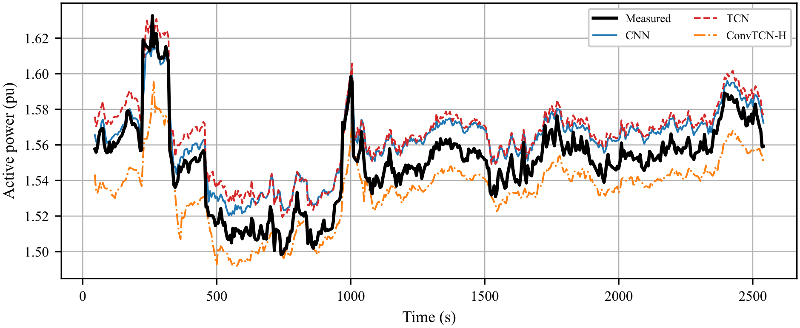
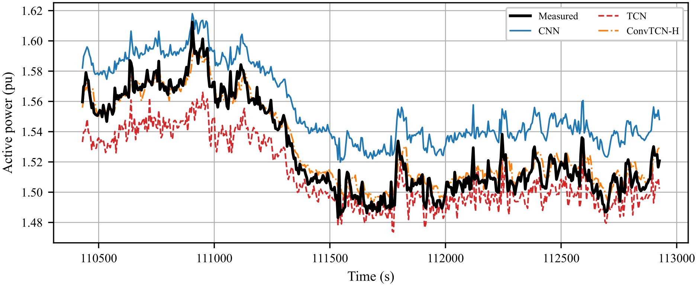

[//]: # (pandoc README.md -o README.pdf --pdf-engine=pdflatex)

<h1 align="center">Shipboard Electric Load Forecasting</h1>

<div align="center">
  [](https://en.wikipedia.org/wiki/Command-line_interface)
  [](https://www.python.org/)
  [](https://github.com/jax-ml/jax)
  [](https://www.tensorflow.org/)
  [](https://scikit-learn.org/)
</div>


An extensible multivariate, multi-horizon forecasting workbench with shipboard electric-load forecasting as its reference application.

The repository loads `.parquet` datasets, reconstructs timestamps, resamples and cleans signals, builds supervised lookback/horizon windows, trains forecasting models, evaluates them on inverse-scaled predictions, and saves metrics, figures, models, and run metadata.

Current target:

- direct multi-step forecasting over a configurable horizon for active power in per-unit: `act_pow_pu`
- input features from operational commands, reactive power, and meteo-marine signals

The original operational measurements are restricted and are not included. Bundled synthetic datasets support reproducible workflow tests.

## Contents

- [What this repository does](#what-this-repository-does)
- [Installation](#installation)
- [Why it matters](#why-it-matters)
- [Repository structure](#repository-structure)
- [Quickstart](#quickstart)
- [Terminal UI](#terminal-ui)
- [Data](#data)
- [Configuration](#configuration)
- [Hyperparameter Tuning (optional)](#hyperparameter-tuning-optional)
- [Outputs](#outputs)
- [Method](#method)
- [Models](#models)
- [Reproduce Results](#reproduce-results)
- [Tests](#tests)
- [Results and Figures](#results-and-figures)
- [Limitations](#limitations)
- [Roadmap](#roadmap)
- [Contributing](#contributing)
- [Citation](#citation)
- [License](#license)

## What This Repository Does

The main workflow is:

```text
parquet files
  -> timestamp reconstruction
  -> signal-aware resampling and gap handling
  -> leg-based train/validation/test split
  -> train-only standardization
  -> supervised window creation
  -> model training
  -> inverse-scaled evaluation
  -> saved models, metrics, figures, and metadata
```

Main entry points:

| File | Purpose |
|---|---|
| `train_load_forecasters.py` | Main training and evaluation script. |
| `load_forecasting/cli.py` | Lightweight command dashboard for status, presets, training, results, and tests. |
| `run_benchmark.py` | Runs a lookback/horizon benchmark grid for `manoeuvre` or `navigation`. |
| `postprocess_figures.py` | Dispatcher for optional post-processing figure workflows. |
| `dataframes_toparquet.py` | CSV-to-parquet conversion utility. |
| `measure_inference_latency.py` | Inference-latency post-processing utility. |
| `recall_results.py` | Legacy post-evaluation and plotting workflow. |

The reusable code lives in the `load_forecasting/` package. The main script orchestrates a run; package modules contain config validation, preprocessing, windowing, Keras and Flax model builders, training helpers, metrics, plots, post-processing, and metadata persistence.

## Installation

The project targets Python 3.11-3.13.

Create and activate a virtual environment from the repository root.

<details open>
<summary><b>Linux / macOS</b> (bash, zsh)</summary>

```bash
python3 -m venv .venv
source .venv/bin/activate
```

</details>

<details>
<summary><b>Windows</b> (PowerShell)</summary>

```powershell
python -m venv .venv
.\.venv\Scripts\Activate.ps1
```

</details>

Every command below is run with the environment active, where `python` and `pip`
resolve to the ones inside `.venv` on all platforms.

Install the package in editable mode with the dependency set needed for your work:

| Use | Command |
|---|---|
| Training and evaluation | `pip install -e ".[ml]"` |
| Development and tests | `pip install -e ".[ml,dev]"` |
| Flax/JAX development | `pip install -e ".[ml,jax,dev]"` |
| Flax/JAX tuning | `pip install -e ".[ml,jax,tune]"` |

Every option installs the `predict-timeseries` command.

Dependencies are declared in `pyproject.toml`.

## Why It Matters

A shipboard electrical plant is islanded: there is no external grid to absorb a load step. An unanticipated demand transient must be covered by strategic loading of the generating set, by starting a further electric generator, or by using a storage system. For this reason, a common practice is to set reserve margins conservatively and to hold prime movers at less efficient part-load operating points.

The idea is to forecast the load ahead to let an energy management system use forecast-enhanced state information before the transient instead of reacting to it: pre-dispatching generating sets, scheduling the storage contribution, and reducing the reserve carried continuously.

This repository covers the forecasting side of that problem. It provides a preprocessing and evaluation pipeline with leg-based splits and train-only scaling, so that model families can be compared on identical windows and inverse-scaled metrics.
The intended suite is useful to benchmark time series model families for various applications.

It does not include an EMS controller, and the reported numbers depend on the restricted dataset described under [Data](#data). A synthetic dataset for the user trials is also provided.

## Repository Structure

```text
.
|-- config/
|   |-- default_config.json       default configuration, wired to the bundled demo
|   |-- model_specs.json          model hyperparameters and builder settings
|   |-- my_system_config.json     your own configuration, git-ignored
|   \-- presets.json              experiment presets
|-- data/                         local parquet input files, not committed
|-- load_forecasting/
|   |-- cli.py                    package-native terminal command dashboard
|   |-- bess.py                   BESS/frequency-domain sizing analysis
|   |-- config.py                 CLI/config validation helpers
|   |-- data_prep.py              datetime parsing, preprocessing, feature engineering
|   |-- eda.py                    exploratory analysis workflows
|   |-- metrics.py                aggregate and horizon-wise metrics
|   |-- models/                   baseline, deep, and hybrid model builders
|   |-- pca_dpca.py               PCA and dynamic PCA diagnostics
|   |-- plots.py                  plotting helpers
|   |-- postprocessing.py         overlapping forecast stitching
|   |-- save_metadata.py          run summary and metadata persistence
|   |-- training.py               flat, Keras, and hybrid train/evaluate helpers
|   |-- training_flax.py          Flax train/evaluate helpers
|   \-- windowing.py              supervised multi-horizon window creation
|-- outputs/                      generated models, metrics, figures, and archives
|   |-- figures/
|   |   |-- diagnostic/           generated exploratory and diagnostic figures
|   |   |-- eps/                  optional EPS exports
|   |   \-- paper/                optional paper-ready figures
|   |-- runs/                     generated models, metrics, windows, metadata
|   \-- test_results/             archived benchmark/test result artifacts
|-- scripts/                      optional tuning, seed-sweep, significance, and figure-generation workflows
|-- tests/                        lightweight regression tests
|-- pyproject.toml                package metadata and optional dependencies
|-- README_TUI.md                 TUI usage details
|-- train_load_forecasters.py
|-- run_benchmark.py
|-- postprocess_figures.py
\-- tui.py
```

### Platform Notes

Single-line `python` and `predict-timeseries` commands are cross-platform. Virtual-environment activation, file copying, multiline continuations, and environment-variable syntax are shell-specific; bash examples may need PowerShell equivalents on Windows.

| Platform | Notes |
|---|---|
| Linux | Debian/Ubuntu need the stdlib venv module first: `sudo apt install python3.12-venv`. |
| macOS | `xgboost` requires the OpenMP runtime: `brew install libomp`. TensorFlow runs CPU-only on Apple Silicon unless `tensorflow-metal` is installed separately; JAX is CPU-only. |
| Windows | JAX ships no CUDA builds for native Windows; GPU training of the Flax models runs under WSL2 (Windows Subsystem for Linux 2 - details reported in the following subsection). |

### GPU Training via WSL (optional)

CPU-only runs are sufficient for the demo, the Ridge/XGBoost baselines, and the test suite. The GPU path matters only for the multi-seed Flax benchmark.

JAX no longer ships CUDA builds for native Windows, so GPU training of the Flax models runs under WSL2 (Ubuntu). Keep the repository and the virtual environment on the WSL-native filesystem (for example `~/predict-timeseries`, not `/mnt/c/...` or `/mnt/d/...`): training I/O and Optuna's sqlite storage are slower and lock-prone on `/mnt/*`.

```bash
python -m venv .venv
source .venv/bin/activate
pip install -e ".[ml,jax,tune]"
pip install "jax[cuda12]"
```

Verify the GPU is picked up: any `--backend flax` run prints a startup line such as

```text
JAX devices: [CudaDevice(id=0)] | default backend: gpu
```

If it prints `CpuDevice` instead, JAX fell back to CPU: check the NVIDIA driver on Windows and the `jax[cuda12]` install.

Python version: `tensorflow==2.20.0` ships no wheels for Python >= 3.14. On distros whose default is newer (e.g. Ubuntu 26.04), create the venv from a pinned interpreter, for example with uv: `uv venv --python 3.12 --seed .venv`.

For the end-to-end tuning, seed-sweep, aggregation, and figure workflow, see
[Full Benchmark Protocol](#full-benchmark-protocol).

## Quickstart

The commands below explicitly select the bundled synthetic configuration, so the demo remains independent of any local operational-data configuration.

1. Inspect available presets:

```bash
predict-timeseries --presets
```

2. Preview a CPU-friendly Ridge demo:

```bash
predict-timeseries train --config config/demo_config.json --preset navigation --models ridge --run-dir outputs/runs/demo_navigation --skip-eda --skip-plots --dry-run
```

3. Run the demo:

```bash
predict-timeseries train --config config/demo_config.json --preset navigation --models ridge --run-dir outputs/runs/demo_navigation --skip-eda --skip-plots
```

For routine calculations, create `config/my_system_config.json` as described under [Configuration](#configuration), then omit `--config`: the local file is preferred automatically when it exists.

Common commands:

```bash
python train_load_forecasters.py --preset manoeuvre
python train_load_forecasters.py --preset navigation
python train_load_forecasters.py --config config/my_system_config.json --preset navigation
python train_load_forecasters.py --preset manoeuvre_fast --models cnn,tcn --epochs 3
python train_load_forecasters.py --preset manoeuvre_fast --backend flax --models dlinear,itransformer --epochs 3
```

The options combine in this order:

```text
system config -> input files, columns, and physical-system settings
preset        -> operating selector, lookback/horizon, and run defaults
CLI flags     -> explicit overrides such as backend, models, and epochs
```

| Command | Effective run |
|---|---|
| `--preset manoeuvre` | Uses the automatic system config, selects manoeuvring data, uses 20 lookback steps and a 5-step horizon, and runs all configured models. |
| `--preset navigation` | Uses the automatic system config, selects navigation data, uses 50 lookback steps and a 25-step horizon, and runs all configured models. |
| `--config config/my_system_config.json --preset navigation` | Runs the navigation preset while explicitly recording the local system configuration in the command. |
| `--preset manoeuvre_fast --models cnn,tcn --epochs 3` | Starts from the fast manoeuvring preset, limits training to CNN and TCN, and overrides its default five epochs with three. |
| `--preset manoeuvre_fast --backend flax --models dlinear,itransformer --epochs 3` | Starts from the fast manoeuvring preset, switches to Flax, selects DLinear and iTransformer, and trains each for three epochs. |

Without `--config`, `config/my_system_config.json` is used when present; otherwise the bundled default configuration is used.

Run a benchmark grid:

```bash
python run_benchmark.py --selector manoeuvre
python run_benchmark.py --selector navigation
```

Run optional post-processing:

```bash
python postprocess_figures.py --kind all
```

## Terminal UI

The `predict-timeseries` command is a lightweight Typer + Rich wrapper around the existing scripts. Common commands are:

```bash
predict-timeseries --status
predict-timeseries --presets
predict-timeseries train --preset navigation --models ridge --dry-run
predict-timeseries test
```

Use `--dry-run` before expensive commands. See [README_TUI.md](README_TUI.md) for results, benchmarks, post-processing, workspace selection, and the compatibility `tui.py` wrapper.

## Data

### Expected Input Format

Input files should be `.parquet` files placed under `data/`.

The default configuration expects columns that can be mapped to:

| Signal | Meaning |
|---|---|
| `date` | Date string |
| `time` | Time string |
| `act_pow_kW` | Active power |
| `react_pow_kVAR` | Reactive power |
| `man_selector_port` | Port manoeuvre selector |
| `man_selector_starboard` | Starboard manoeuvre selector. |
| `lever_port` | Port lever command |
| `lever_starboard` | Starboard lever command |
| `air_temp` | Air temperature |
| `wind_intensity` | Wind intensity |
| `sea_temp` | Sea temperature |
| `sea_state` | Sea state |

Column names are configurable through `config/my_system_config.json`.

### Bundled Synthetic Demo

The repository includes the `demo_navigation.parquet` and `demo_manoeuvre.parquet` datasets. These deterministic datasets are independently simulated by `scripts/generate_demo_data.py`. They demonstrate the software workflow only and cannot reproduce or validate real results. Run the navigation demo through the [Quickstart](#quickstart); select the `manoeuvre` preset for its manoeuvring counterpart.

Regenerate both files deterministically from `config/demo_config.json`:

```bash
python scripts/generate_demo_data.py --force
```

### Confidentiality

Except for the named synthetic demo files, do not commit raw operational data. The local `data/` folder is intended for private input files.

Do not upload classified, sensitive, personal, or commercially restricted data.

### Trusted Artifacts

Treat saved model and preprocessing artifacts as trusted local files only. Files such as `*.pkl`, `*.joblib`, `*.keras`, and `*.npz` can contain executable or sensitive serialized state depending on format and producer. Do not load artifacts from email, public issues, untrusted repositories, or unknown experiment archives.

If an artifact must be shared, prefer regenerated metrics, figures, or documented config over serialized runtime objects. When serialized artifacts are unavoidable, share them through an access-controlled channel and record their provenance.

## Configuration

Configuration is split into the following files:

| File | Purpose |
|---|---|
| `config/default_config.json` | Default configuration, wired to the bundled synthetic demo so a fresh clone runs out of the box |
| `config/my_system_config.json` | Your own ship, plant, or measurement setup. Git-ignored, so private file names and ratings stay local |
| `config/presets.json` | Experiment presets: selector, lookback, horizon, models, batch sizes, plotting flags |
| `config/model_specs.json` | Model labels, builders, losses, batch sizes, learning rates, and builder arguments |

To run on your own data, copy the default configuration and edit the file names, column mapping, and power rating:

<details open>
<summary><b>Linux / macOS</b></summary>

```bash
cp config/default_config.json config/my_system_config.json
```

</details>

<details>
<summary><b>Windows</b> (PowerShell)</summary>

```powershell
Copy-Item config\default_config.json config\my_system_config.json
```

</details>

Once this file exists, it becomes the automatic default. Continue with normal
preset commands:

```bash
python train_load_forecasters.py --preset navigation
```

To make the input configuration explicit in a recorded command, use:

```bash
python train_load_forecasters.py --config config/my_system_config.json --preset navigation
```

`config/my_system_config.json` is git-ignored: your dataset never reaches the repository.

CLI flags override preset values.

Available preset fields:

```text
selector
lookback
horizon
run_dir
backend
skip_eda
skip_plots
load_dynamics
models
epochs
batch_size
learning_rate
predict_batch_size
seed
model_specs
resume
```

Dataset selectors:

| Selector | Intended scope |
|---|---|
| `navigation` | Navigation legs |
| `manoeuvre` | Manoeuvring legs |
| `all` | Combined dataset scope |

Example:

```bash
python train_load_forecasters.py --preset-file config/presets.json --preset all_paper
```

## Hyperparameter Tuning (optional)

Hyperparameter tuning is performed with the Optuna library. Optuna tunes Flax models on validation loss using TPE and median pruning. The default training flow does not require tuning; omitting `--model-specs` uses `config/model_specs.json` unchanged. See [Full Benchmark Protocol](#full-benchmark-protocol) for the canonical cache, tuning, seed-sweep, and analysis commands.

Global `epochs`, `batch_size`, and `learning_rate` overrides take precedence over
tuned per-model values; the trainer warns when this happens.

## Outputs

By default, run artifacts are written under `outputs/runs/`.

Typical files:

| Output | Meaning |
|---|---|
| `run_summary.json` | Complete local run metadata, including paths and the exact command; keep private when it contains operational details |
| `run_summary_public.json` | Allowlisted provenance and run metadata suitable for review before sharing |
| `results_metrics.parquet` | Canonical typed metrics, including array-valued horizon and target-axis results |
| `results_metrics.csv` | Compact horizon-wise and aggregate metrics for inspection and benchmark aggregation |
| `scalers_and_meta.pkl` | Scalers, feature/target names, sampling rate, window sizes, run metadata. |
| `windows.npz` | Serialized train/validation/test window tensors |
| `predictions/*.npz` | Saved validation/test predictions in physical units |
| `model_ridge.joblib` | Ridge baseline |
| `model_xgb.joblib` | XGBoost model |
| `model_*.keras` | Keras deep or hybrid models |
| `model_*_flax/params/` | Orbax checkpoint containing Flax model parameters |
| `model_*_flax/preprocess.npz` | Feature and target scaling state |
| `model_*_flax/golden_io.npz` | Reference input and prediction for artifact verification |
| `model_*_flax/manifest.json` | Model reconstruction metadata, data contract, runtime versions, parameter count, and optional FLOPs estimate |
| `outputs/runs/**/img/*.png` | Run-local diagnostic and comparison figures |
| `outputs/figures/eps/*.eps` | Optional EPS exports |
| `<sweep-root>/aggregated_metrics.csv` | Per-model mean/std across seed runs (`scripts/aggregate_seed_results.py`) |
| `<sweep-root>/significance/*` | Diebold-Mariano tests, Holm-adjusted p-values, LaTeX table (`scripts/run_significance.py`) |

Inspect results quickly:

```bash
predict-timeseries --results
```

## Method

### Preprocessing

The preprocessing pipeline:

- reconstructs timestamps from `date` and `time`;
- removes duplicate timestamps;
- resamples to a fixed cadence;
- forward-fills step-like signals over bounded gaps;
- time-interpolates continuous signals over bounded gaps;
- converts active/reactive power to per-unit using the configured rating;
- preserves validity masks so invalid ranges can be excluded from windows.

Default sampling policy:

- `Ts = "1s"`
- `max_fill_seconds = 45`

These are configured in the JSON config files.

### Split and Scaling

The intended split protocol is leg-based train/validation/test separation.

Continuous variables are standardized with train-only statistics:

```text
z = (x - mean_train) / std_train
```

The same train-fitted scaler is applied to validation and test data. Predictions are inverse-scaled before metrics are reported.

### Windowing

The model learns a direct multi-output mapping:

```text
Y_hat[t+1:t+H] = f(X[t-L+1:t])
```

where:

- `L` is `LookbackSteps`;
- `H` is `HorizonSteps`;
- `WindowSlidingCoeff` controls overlap between adjacent windows.

Tensor shapes:

```text
X:           (num_samples, LookbackSteps, num_features)
Y:           (num_samples, HorizonSteps, output_dim)
flat X:      (num_samples, LookbackSteps * num_features)
flat Y:      (num_samples, HorizonSteps * output_dim)
prediction:  (num_samples, HorizonSteps, output_dim)
```

## Models

Implemented model families:

| Family | Models |
|---|---|
| Baselines | Ridge regression, XGBoost |
| Deep sequence models | MLP, GRU, RNN, CNN, TCN, Transformer, DLinear, iTransformer |
| Hybrid models | DualStream-FiLM, ConvLSTM-H, TCN-LSTM-H, ConvTCN-H, ConvLSTMTCN-H |
| Zero-shot foundation models | Chronos-2, TimesFM 2.5, TiRex-2 (`scripts/run_foundation_models.py`) |
| Online aggregation | COAST, the mixture of the trained models and persistence (`scripts/fusion_mixture_replay.py`) |

Baselines use flattened windows. Keras and Flax models use 3D sequence tensors.
DLinear and iTransformer are available through the Flax backend.

Training uses validation monitoring, early stopping, and learning-rate scheduling where applicable.

## Reproduce Results

Because the original data are restricted, full numerical reproduction requires access to equivalent input `.parquet` files with the configured schema.

To make a run reproducible:

1. keep the same input files;
2. keep the same config and preset;
3. keep selector, lookback, horizon, and sliding coefficient fixed;
4. keep train/validation/test leg assignment fixed;
5. keep the private `run_summary.json` locally and share `run_summary_public.json` only after review;
6. save `results_metrics.parquet`, the compact `results_metrics.csv`, model files, scalers, and window arrays.

Suggested smoke test:

```bash
predict-timeseries train --preset manoeuvre_fast --models cnn --epochs 1 --dry-run
python train_load_forecasters.py --preset manoeuvre_fast --models cnn --epochs 1
python train_load_forecasters.py --preset manoeuvre_fast --backend flax --models dlinear --epochs 1
```

### Full Benchmark Protocol

End-to-end protocol for the full multi-seed benchmark, per preset (shown for
`manoeuvre_paper`; repeat with `navigation_paper`). On GPU, use the WSL setup under
[Installation](#installation), keep the checkout and Optuna database on the
WSL-native filesystem, and activate the environment in each new shell:

```bash
cd ~/predict-timeseries && source .venv/bin/activate
```

```bash
# 1. Cache windows once (fast ridge run; reused by tuning)
python train_load_forecasters.py --preset manoeuvre_paper --backend flax --models ridge --run-dir outputs/runs/windows_manoeuvre_paper

# 2. Tune the Flax models (optional and resumable; run inside tmux for overnight jobs)
python scripts/tune_hyperparams.py --preset manoeuvre_paper \
    --windows-dir outputs/runs/windows_manoeuvre_paper \
    --models cnn,tcn,transformer,itransformer,dual_stream_film,convtcn_hybrid,convlstmtcn_hybrid,dlinear \
    --n-trials 20 --storage sqlite:///$HOME/optuna.db

# 3. Tuning figures
python scripts/gen_optuna_figures.py --storage sqlite:///$HOME/optuna.db

# 4. Five-seed sweep with the tuned specs -> outputs/runs/sweep_manoeuvre_paper_flax/seed<k>/
python scripts/run_seed_sweep.py --preset manoeuvre_paper --backend flax --seeds 0,1,2,3,4 --models cnn,tcn,transformer,itransformer,dual_stream_film,convtcn_hybrid,convlstmtcn_hybrid,dlinear --model-specs config/model_specs_tuned_manoeuvre_paper.json

# 5. Aggregate metrics across seeds (aggregated_metrics.csv)
python scripts/aggregate_seed_results.py --run-root outputs/runs/sweep_manoeuvre_paper_flax

# 6. Pairwise Diebold-Mariano significance tests (significance/ tables and heatmap)
python scripts/run_significance.py --run-root outputs/runs/sweep_manoeuvre_paper_flax

# 7. Figures
python postprocess_figures.py --kind all
python scripts/gen_figures_4papers.py

# 8. Foundation-model full-test figures from cached predictions
python postprocess_figures.py --kind foundation_full_test
```

Commit the tuned `config/model_specs_tuned_<preset>.json` files so step 4 is reproducible without rerunning the search.

## Tests

With the development dependencies from [Installation](#installation), run:

```bash
python -m pip check
python -m ruff check .
predict-timeseries check
python -m pytest
```

or through the TUI:

```bash
predict-timeseries test
```

CI runs the same checks on Python 3.11 after a clean, non-editable install. Current tests cover configuration merging, leg-disjoint splitting, train-only scaling, group-safe windowing, CLI/workspace forwarding, artifact persistence, and model shape checks. They do not run a complete end-to-end training campaign or reproduce paper results.

## Results and Figures

Existing generated outputs in `outputs/runs/`, `outputs/figures/diagnostic/`, and `outputs/figures/paper/` are examples from prior local experiments.

The canonical metrics table is `results_metrics.parquet`; use it when preserving typed array-valued metrics. The compact `results_metrics.csv` contains:

- `RMSE_horizon`
- `MAE_horizon`
- `MAPE_horizon`
- `MAPE_boot_mean`
- `MAPE_boot_ci95_low`
- `MAPE_boot_ci95_high`
- `RMSE_all`
- `MAE_all`
- `MAPE_all`

The Parquet table additionally stores `MAPE_targetax`.

Figures may include:

- exploratory distributions and correlations;
- horizon-wise error curves;
- lookback/horizon benchmark heatmaps;
- true-vs-predicted scatter plots;
- stitched full-test trajectory comparisons.

Example figure paths:

```text
outputs/figures/diagnostic/test_distribution_scatter.png
outputs/figures/diagnostic/models_comparison_full_test.png
outputs/figures/paper/mape_vs_lookback_H5_man.png
outputs/figures/paper/models_comparison_full_test_man.png
outputs/figures/paper/models_comparison_full_test_nav.png
```

The two figures embedded below are publication copies stored under `docs/figures/`
so they render in the public repository. Regenerated run artifacts remain under
ignored `outputs/` directories.

Example stitched full-test trajectory for manoeuvring:



Example stitched full-test trajectory for navigation:



Do not treat bundled/generated figures as universal benchmark claims. They depend on the private dataset, selected preset, and run configuration.

## Limitations

- Raw measurement data are not included.
- Deep architectures can be expensive and may need systematic hyperparameter tuning.
- Some optional EDA, PCA/dPCA, BESS, and legacy post-processing workflows remain available for research diagnostics.
- Current tests cover core leakage boundaries at unit level, but not full model training or end-to-end numerical reproducibility.

## Roadmap

Near-term engineering work:

- add one end-to-end synthetic Ridge smoke test;
- add regression checks for the complete run-output contract.

Potential research extensions:

- multi-target active/reactive power forecasting;
- stronger uncertainty/error analysis;
- deployment-oriented memory profiling;
- improved model comparison across operating regimes.

## Contributing

Issues and pull requests are welcome, in particular for the items listed under [Roadmap](#roadmap).

### Code

- Keep changes small and reviewable; do not reformat unrelated code.
- Preserve the tensor-shape conventions documented under [Windowing](#windowing) and the train-only scaling protocol under [Split and Scaling](#split-and-scaling).
- Add new models through a builder in `load_forecasting/models/` plus the corresponding entry in `config/model_specs.json`, rather than wiring them into the training script.
- Run the commands under [Tests](#tests) before opening a pull request.

### Operational data

The most useful scientific contribution is a dataset from a different vessel or plant, which makes the comparison less dependent on a single ship. Open an issue before sharing anything, and describe:

- sampling rate and time base;
- physical units and sign conventions for every channel;
- the electrical rating used for the per-unit conversion;
- vessel or plant metadata you are allowed to disclose (propulsion arrangement, generating-set configuration, installed storage);
- how the record is segmented into operating legs;
- known gaps, outages, and sensor faults.

Anonymise identifiers before sharing. Do not attach classified, navigation-sensitive, credential-bearing, personal, or commercially restricted material to issues or pull requests; see [Confidentiality](#confidentiality).

### Reported results

For a contributed result to be comparable, include the exact command, the config and preset files used, the seed, and the resulting `run_summary_public.json`, `results_metrics.parquet`, and compact `results_metrics.csv`. Note the hardware, the backend (`keras` or `flax`), and the wall-clock cost. Review every public artifact before sharing it.

Prefer regenerated metrics and figures over serialized runtime artifacts; see [Trusted Artifacts](#trusted-artifacts).

## Citation

If you use this repository in research or reports, cite the repository:

```bibtex
@software{belvisi_predict_timeseries_2026,
  author = {Daniele Belvisi},
  title = {{predict-timeseries}: shipboard load forecasting benchmark and online aggregation},
  year = {2026},
  url = {https://github.com/danieleb1861/predict-timeseries}
}
```

The method and the results are described in the companion article "Context-aware online aggregation for real-time shipboard load forecasting with field-data validation and computational benchmarking", currently under review. The scripts behind each of its figures and tables are listed in [scripts/README.md](scripts/README.md#paper-figures-and-tables).

## License

Distributed under the MIT License. See [LICENSE](LICENSE).
